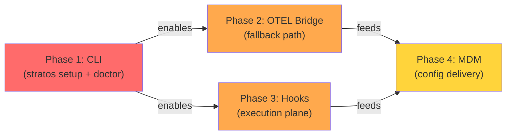

# Stratos SDK Plan: Complete Analysis & Gap Review

**Last Updated:** 2026-10-08  
**Current Version:** v1.3.4 (Agent Phase Complete)  
**Next Phase:** v1.4+ (Developer Capture Implementation)

---

## Executive Summary

The Stratos SDK **Plan 1** targets capturing Claude usage + execution across developer machines (Code/Chat/Cowork). 

**Phase breakdown:**
- **S-M0 (Done):** Agent instrumentation via OpenLLMetry (v1.3.4 + P1 security fixes)
- **S-M1 (Next):** Developer setup (`stratos setup`, `stratos doctor`) 
- **S-M2 (Parallel):** OTEL bridge for non-injection surfaces
- **S-M3 (Parallel):** Execution hooks + skill/subagent tracking
- **S-M4 (Final):** MDM packaging + self-check

---

## What's Complete (v1.3.4)

### Security Foundation (7 P1 Fixes — Just Landed)

| Issue | Fix | Status |
|-------|-----|--------|
| **P1-01** | https.get() bypass | ✅ Wrapped in enforcement.js |
| **P1-02** | Missing AI providers | ✅ Added "api." wildcard |
| **P1-03** | Unblockable agent (401) | ✅ Treat 401/403 as blocked |
| **P1-04** | Privacy leak (prompts) | ✅ Respect STRATOS_RECORD_INPUTS |
| **P1-05** | Orphaned tool processes | ✅ Close stdin, forward signals |
| **P1-06** | Windows shell injection | ✅ Cross-spawn + no shell |
| **P1-07** | Broken projects on install fail | ✅ Backup/restore package.json |

### Agent Instrumentation (Production Ready)

```
OpenLLMetry Injection
├─ register.js              [NODE_OPTIONS --import entry]
├─ index.js                 [Traceloop init + heartbeat]
├─ enforcement.js           [Budget blocking + guard] ← P1 FIXES
└─ mcp-proxy.js             [Tool metering] ← P1 FIXES

Vercel AI Auto-Telemetry
├─ vercel-ai.js             [Vercel AI integration]
└─ vercel-ai-inject.js      [Content-off flags] ← P1 FIX

LangChain Compatibility
├─ inspect-langchain.js     [Version check] ← P1 FIX
└─ cli-inspect.js           [stratos-inspect command]
```

**Usage:**
```bash
npm install @intelli-1113/stratos-sdk
node --import @intelli-1113/stratos-sdk/register app.js
```

**What it does:**
- Captures all LLM provider calls via OpenLLMetry → Stratos telemetry
- Blocks agents when budget exhausted / revoked
- Validates LangChain 1.x compatibility
- Meters MCP tool calls
- Content-free by default (STRATOS_RECORD_INPUTS=0)

---

## What's Missing (S-M1 → S-M4)

### S-M1: Usage Plane + Setup Command

**Gap:** No way for developers to set up their Claude Code session

**Required:**
1. **`stratos setup claude-code`** command
   - Detect Claude Code installation
   - Choose capture tier (injection vs. OTEL)
   - Write ~/.claude/settings.json + .env
   - Run stratos doctor to verify

2. **`stratos doctor`** command
   - Validate token + URL reachable
   - Confirm hooks registered
   - Test exporter connectivity
   - Print remediation steps

**Impact:** WITHOUT this, developers can't onboard. S-M1 is the critical path.

---

### S-M2: OTEL Bridge

**Gap:** No way to capture from closed-GUI surfaces (if Chat/Cowork aren't CLIs)

**Required:**
1. **Localhost OTEL receiver** (port 4318)
   - Listens for standard OTLP metrics/logs
   - Maps to Stratos usage spans
   - Content-off redaction

2. **Bridge harness**
   - Subprocess manager (reuse mcp-proxy pattern)
   - Automatic restart on failure
   - Token management (via env, not URL)

**Fallback Path:** If injection fails, native OTEL → bridge guarantees floor.

---

### S-M3: Execution Plane (Hooks + Skills)

**Gap:** No visibility into skill invocation, subagent execution, plugin loading

**Required:**
1. **Hooks system** in Claude Code
   - PreToolUse, PostToolUse, SessionStart/Stop, SubagentStop, UserPromptSubmit
   - Post content-free execution spans

2. **Execution span schema**
   - skill: skill invoked
   - subagent: child agent spawned
   - hook: event fired
   - cmd: CLI command
   - plugin: plugin loaded
   - mcp: tool accessed

3. **Claude Code integration** (external dependency)
   - Plugin auto-registers hooks on `npm i -g`
   - Writes to ~/.claude/settings.json

**Parallel Work:** Can happen while S-M2 is finishing. Depends on Claude Code team.

---

### S-M4: MDM Delivery

**Gap:** No way to deliver config without manual developer setup

**Required:**
1. **MDM bundle template**
   - Per-surface STRATOS_TOKEN (person × surface)
   - STRATOS_URL, content-off flags
   - Hook config

2. **Config helper utilities**
   - Generate bundles from enrollment
   - Merge with existing Claude Code config
   - Self-heal missing hooks

**Dependency:** Stratos-app (Plan 2, A-M4) defines token schema + enrollment.

---

## Critical Path to S-M1 Completion



**Red:** Must complete before S-M1 ships  
**Orange:** Can start in parallel, unblock S-M4  
**Yellow:** Final assembly

---

## Definition of Done (Each Milestone)

### S-M1: Developer Can Onboard
```bash
✅ npm i -g @intelli-1113/stratos-sdk
✅ stratos setup claude-code        # Auto-detects + configures
✅ stratos doctor                   # ✓ Connected to Stratos
✅ Stratos dashboard shows: alice · code with usage
```

### S-M2: Injection Fallback
```bash
✅ OTEL_EXPORTER_OTLP_ENDPOINT=http://localhost:4318
✅ Bridge translates OTLP → Stratos spans
✅ Content-off: prompt/response null
✅ Same alice · code appears on Stratos
```

### S-M3: Execution Tracking
```bash
✅ skill: invoke → POST span
✅ subagent: spawn → POST span
✅ hook: event → POST span
✅ Stratos dashboard shows skill + subagent tree for alice · code
```

### S-M4: Zero-Touch Deployment
```bash
✅ MDM provides: token + URL + hooks config
✅ Developer: `npm i -g @intelli-1113/stratos-sdk`
✅ Developer: runs stratos doctor → ✓ Connected
✅ No manual editing of ~/.claude/ files needed
```

---

## Architecture: Person × Surface Identity

**Today (Agent Phase):**
```
service-name → token → OpenLLMetry spans → /api/ingest
```

**Plan (Developer Phase):**
```
person × surface → token → spans (usage + execution) → /api/ingest
  ├─ alice · code     → sk_dev_alice_code_...
  ├─ alice · chat     → sk_dev_alice_chat_...
  └─ alice · cowork   → sk_dev_alice_cowork_...
```

Each surface = separate agent in `agents` table, same `owner_email`.

---

## Implementation Sequence (Recommended)

### Week 1-2: Phase 1 (S-M1) — Critical Path
- [ ] CLI infrastructure (cli.js, cli-setup.js, cli-doctor.js)
- [ ] Detection: Claude Code installation + OS
- [ ] Config write: ~/.claude/settings.json + .env
- [ ] Validation: doctor checks all fields
- [ ] Test: setup → doctor flow on Mac/Windows/Linux

**Unlock:** S-M1 complete, developers can onboard

### Week 2-3: Phase 2 (S-M2) — Parallel Track
- [ ] OTEL bridge (otel-bridge.js)
- [ ] Harness (otel-bridge-harness.js)
- [ ] OTLP → Stratos span translation
- [ ] Content-off redaction
- [ ] Test: real OTEL exporter → Stratos

**Unlock:** Non-injection capture (fallback path)

### Week 2-3: Phase 3 (S-M3) — Parallel Track (Blocked by Claude Code)
- [ ] Execution span schema (execution-spans.js)
- [ ] Hook registration in settings.json
- [ ] Claude Code plugin (external deliverable)
- [ ] Test: skill → span, subagent → span

**Unblock:** Requires Claude Code team coordination

### Week 3-4: Phase 4 (S-M4) — Final Assembly
- [ ] Config templates (config-templates.js)
- [ ] MDM bundle generator
- [ ] Doctor enhanced: detect surface type + validate tokens
- [ ] Integration test: MDM → setup → doctor → Stratos

**Ship:** v1.4.0 with all four milestones

---

## Risks & Mitigation

| Risk | Likelihood | Impact | Mitigation |
|------|------------|--------|-----------|
| Claude Code path detection fails | Medium | S-M1 blocked | Heuristic fallback + test matrix |
| Settings file collision (.claude/) | Medium | Config loss | Merge strategy, backup on write |
| OTEL spec variance (versions) | Low | S-M2 fails | Test against multiple OTEL versions |
| Hooks don't fire (Claude Code delay) | High | S-M3 delayed | Start Phase 3 in parallel, gate S-M4 only |
| MDM format undefined (Stratos-app) | Medium | S-M4 blocked | Coordinate early with Plan 2 team |

---

## Success Metrics (v1.4 Release)

```
Developer Onboarding (S-M1):
  ✓ stratos setup succeeds on 3+ platforms
  ✓ doctor validates without manual intervention
  ✓ Enrollment time: <5 min end-to-end

Coverage (S-M1 + S-M2):
  ✓ Claude Code: injection (primary)
  ✓ Fallback: OTEL bridge (if injection unavailable)
  ✓ Content-free: 100% redaction when flag set

Execution Tracking (S-M3):
  ✓ Skills appear as nodes in Stratos dashboard
  ✓ Subagent nesting captured
  ✓ Hook events (start/stop) correlated

Delivery (S-M4):
  ✓ MDM can deploy config without user action
  ✓ doctor validates MDM-delivered config
  ✓ Zero onboarding steps after MDM push
```

---

## Next Steps

1. **Finalize Phase 1 design** with team (CLI UX, config paths, error messages)
2. **Coordinate with Stratos-app** (Plan 2) on token schema + enrollment
3. **Engage Claude Code team** on hooks registration (S-M3 dependency)
4. **Create Phase 1 implementation** (cli.js, cli-setup.js, cli-doctor.js)
5. **Test on real machines** (before S-M1 complete)

---

## Files Created This Session

```
IMPLEMENTATION-ROADMAP.md  ← Detailed file structure + phases
PLAN-ANALYSIS.md           ← This document (executive view)
.claude/plans/...          ← Security fix plan (P1-01 through P1-07)
STRATOS-SDK-FIX-PLAN.md    ← Summary of P1 fixes
```

---

## Reference: The Plan (Quick Index)

| Section | File | Status |
|---------|------|--------|
| Principles | Plan 1, top | ✅ Understood |
| S-M0 (Spike) | Plan 1 | ✅ Complete (v1.3.4 + P1 fixes) |
| S-M1 | Plan 1 | ❌ Next (CLI infrastructure) |
| S-M2 | Plan 1 | ❌ Parallel (OTEL bridge) |
| S-M3 | Plan 1 | ❌ Parallel (Hooks + execution) |
| S-M4 | Plan 1 | ❌ Final (MDM delivery) |
| S-M5 | Plan 1 | ❌ After S-M1/S-M2/S-M3 done |

**Key Documents:**
- Plan 1: `sdk-plan.md` (vision + milestones)
- Implementation: `IMPLEMENTATION-ROADMAP.md` (file structure)
- Fixes: `STRATOS-SDK-FIX-PLAN.md` (security + privacy)

