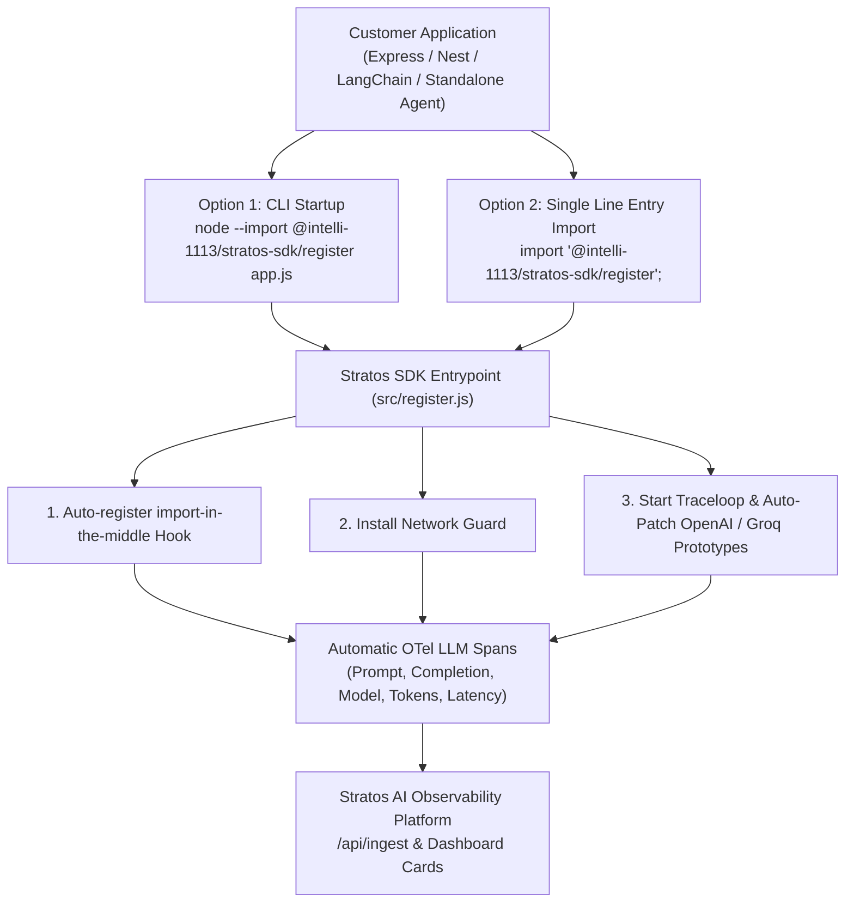

# Stratos SDK Zero-Code Telemetry Integration Plan (v1.4.0)

## Executive Summary

When shipping `@intelli-1113/stratos-sdk` to enterprise customers, telemetry collection must require **zero modifications to customer business logic** or agent source code. Customers should not be forced to manually wrap function calls with `tracer.startSpan()` or edit their LLM client code across multiple services.

This plan details the root causes behind missing metrics in Node.js ESM applications and outlines the exact changes to build **100% Zero-Code Telemetry** directly into `@intelli-1113/stratos-sdk`.

---

## 1. Problem Analysis & Root Cause Diagnosis

### Why Telemetry Spans Were Missing Previously
1. **Node.js ES Module (ESM) Hoisting**:
   In modern Node.js applications (`"type": "module"` in `package.json`), static `import` statements (e.g. `import { OpenAI } from "openai"`) are resolved and evaluated by Node's V8 module graph *before* top-level runtime code executes.
2. **Missing `import-in-the-middle` Loader Hook**:
   Node 18.19+ / 20.6+ / 22+ requires ESM loader hooks (`module.register()`) to intercept ES module imports. OpenTelemetry instrumentations (such as `@traceloop/instrumentation-openai`) rely on `import-in-the-middle` to wrap LLM SDK prototypes. Because `register.js` previously only registered `vercel-ai-loader.js`, native ESM imports of OpenAI/Groq bypassed OpenLLMetry instrumentation.
3. **Custom Provider BaseURLs**:
   OpenAI-compatible clients initialized with custom provider endpoints (such as `baseURL: 'https://api.groq.com/openai/v1'`, Together, Anyscale, Ollama, DeepSeek, vLLM) sometimes bypass standard OpenLLMetry provider classification unless span kind (`traceloop.span.kind = 'llm'`) and token attributes are explicitly populated.

---

## 2. Target Architecture: Zero-Code Auto Instrumentation



---

## 3. Implementation Details

### Component 1: Update `src/register.js` to Auto-Register `import-in-the-middle`

To ensure ESM imports of `openai`, `groq-sdk`, `@anthropic-ai/sdk`, etc. are intercepted at startup without requiring the customer to add extra CLI arguments:

```javascript
// src/register.js
import { register as registerModuleHook } from "node:module";
import { pathToFileURL } from "node:url";
import { dirname, join } from "node:path";
import { fileURLToPath } from "node:url";
import { existsSync } from "node:fs";
import { installNetworkGuard } from "./enforcement.js";

const __dirname = dirname(fileURLToPath(import.meta.url));

// 1. Load .env from cwd
try {
  const envPath = join(process.cwd(), ".env");
  if (existsSync(envPath) && typeof process.loadEnvFile === "function") {
    process.loadEnvFile(envPath);
  }
} catch {}

// 2. Install Network Guard
try {
  installNetworkGuard();
} catch (err) {
  console.warn("[stratos] could not install network guard:", err?.message || err);
}

// 3. Register import-in-the-middle ESM hook for automatic provider instrumentation
try {
  registerModuleHook("import-in-the-middle/hook.mjs", import.meta.url);
} catch (err) {
  /* optional / fallback for CommonJS */
}

// 4. Register Vercel AI loader hook
try {
  registerModuleHook(pathToFileURL(join(__dirname, "vercel-ai-loader.js")).href);
} catch (err) {
  console.warn("[stratos] could not register Vercel AI loader:", err?.message || err);
}

import { start } from "./index.js";
start();
```

---

### Component 2: Auto-Patch OpenAI, Groq (`groq-sdk`), and OpenRouter (`@openrouter/sdk`)

Add automated client prototype patchers inside `start()` in `src/index.js` so that `import { OpenAI } from "openai"`, `import { Groq } from "groq-sdk"`, and `import { OpenRouter } from "@openrouter/sdk"` (including streaming responses and reasoning tokens) automatically produce standard OpenTelemetry spans:

```javascript
// src/index.js (Auto-patch helper for OpenAI, Groq, and OpenRouter)
import { trace } from "@opentelemetry/api";

function enableAutoLLMPatching() {
  try {
    // 1. Intercept OpenAI & Groq prototype methods
    const ModuleNames = ["openai", "groq-sdk"];
    for (const modName of ModuleNames) {
      try {
        const mod = _require(modName);
        const ClientClass = mod?.Groq || mod?.OpenAI || mod?.default;
        if (ClientClass?.prototype?.chat?.completions?.create) {
          patchCompletionsCreate(ClientClass.prototype.chat.completions);
        }
      } catch {}
    }

    // 2. Intercept OpenRouter (@openrouter/sdk) prototype methods
    try {
      const openRouterMod = _require("@openrouter/sdk");
      const OpenRouterClass = openRouterMod?.OpenRouter || openRouterMod?.default;
      if (OpenRouterClass) {
        patchOpenRouter(OpenRouterClass);
      }
    } catch {}
  } catch (e) {
    /* silent fallback */
  }
}

function patchCompletionsCreate(targetObj) {
  if (!targetObj || targetObj.__stratos_patched) return;
  const original = targetObj.create;

  targetObj.create = async function (...args) {
    const params = args[0] || {};
    const model = params.model || "unknown";
    const promptText = typeof params.messages === "string" 
      ? params.messages 
      : JSON.stringify(params.messages || []);

    const tracer = trace.getTracer("@intelli-1113/stratos-sdk");
    const span = tracer.startSpan("llm.chat", {
      attributes: {
        "traceloop.span.kind": "llm",
        "gen_ai.operation.name": "chat",
        "gen_ai.request.model": model,
        "gen_ai.prompt": promptText,
      },
    });

    try {
      const response = await original.apply(this, args);
      const usage = response?.usage || {};
      const content = response?.choices?.[0]?.message?.content || "";

      span.setAttributes({
        "gen_ai.completion": typeof content === "string" ? content : JSON.stringify(content),
        "gen_ai.usage.input_tokens": usage.prompt_tokens || 0,
        "gen_ai.usage.output_tokens": usage.completion_tokens || 0,
        "gen_ai.usage.total_tokens": usage.total_tokens || 0,
      });
      span.end();
      return response;
    } catch (err) {
      span.recordException(err);
      span.end();
      throw err;
    }
  };

  targetObj.__stratos_patched = true;
}

/**
 * Patch OpenRouter SDK (@openrouter/sdk) chat.send method.
 * Handles both streaming (for await chunk of stream) & non-streaming,
 * capturing prompt, completion text, and reasoning tokens.
 */
function patchOpenRouter(OpenRouterClass) {
  const chatProto = OpenRouterClass.prototype?.chat || OpenRouterClass.Chat?.prototype;
  if (!chatProto || chatProto.__stratos_patched) return;
  const originalSend = chatProto.send;

  chatProto.send = async function (...args) {
    const req = args[0]?.chatRequest || args[0] || {};
    const model = req.model || "unknown";
    const promptText = typeof req.messages === "string" ? req.messages : JSON.stringify(req.messages || []);
    const isStream = Boolean(req.stream);

    const tracer = trace.getTracer("@intelli-1113/stratos-sdk");
    const span = tracer.startSpan("llm.chat", {
      attributes: {
        "traceloop.span.kind": "llm",
        "gen_ai.operation.name": "chat",
        "gen_ai.provider.name": "openrouter",
        "gen_ai.request.model": model,
        "gen_ai.prompt": promptText,
      },
    });

    try {
      const result = await originalSend.apply(this, args);

      if (isStream && Symbol.asyncIterator in Object(result)) {
        let accumulatedContent = "";
        let finalUsage = null;

        // Wrap AsyncIterable stream to capture streamed delta content & final chunk usage
        const wrappedStream = (async function* () {
          try {
            for await (const chunk of result) {
              const content = chunk?.choices?.[0]?.delta?.content || chunk?.choices?.[0]?.text || "";
              if (content) accumulatedContent += content;
              if (chunk?.usage) finalUsage = chunk.usage;
              yield chunk;
            }
          } finally {
            span.setAttributes({
              "gen_ai.completion": accumulatedContent,
              "gen_ai.usage.input_tokens": finalUsage?.promptTokens ?? finalUsage?.prompt_tokens ?? 0,
              "gen_ai.usage.output_tokens": finalUsage?.completionTokens ?? finalUsage?.completion_tokens ?? 0,
              "gen_ai.usage.total_tokens": finalUsage?.totalTokens ?? finalUsage?.total_tokens ?? 0,
              "gen_ai.usage.reasoning_tokens": finalUsage?.completionTokensDetails?.reasoningTokens ?? 0,
            });
            span.end();
          }
        })();

        return wrappedStream;
      } else {
        // Non-streaming response
        const content = result?.choices?.[0]?.message?.content || "";
        const usage = result?.usage || {};

        span.setAttributes({
          "gen_ai.completion": typeof content === "string" ? content : JSON.stringify(content),
          "gen_ai.usage.input_tokens": usage.promptTokens ?? usage.prompt_tokens ?? 0,
          "gen_ai.usage.output_tokens": usage.completionTokens ?? usage.completion_tokens ?? 0,
          "gen_ai.usage.total_tokens": usage.totalTokens ?? usage.total_tokens ?? 0,
        });
        span.end();
        return result;
      }
    } catch (err) {
      span.recordException(err);
      span.end();
      throw err;
    }
  };

  chatProto.__stratos_patched = true;
}
```

---

### Component 3: Cloudflare Workers AI (`env.AI.run`) Integration (`src/cloudflare.ts`)

Cloudflare Workers run in serverless V8 isolates at the edge (without Node.js process APIs or Node module loaders). To collect telemetry from Cloudflare Workers AI (`env.AI.run`), `@intelli-1113/stratos-sdk` provides a 1-line wrapper helper `@intelli-1113/stratos-sdk/cloudflare`:

```typescript
// src/cloudflare.ts — Cloudflare Workers AI Telemetry Helper
export function wrapCloudflareAi<T extends { run: Function }>(
  aiBinding: T,
  config: { token: string; url?: string; appName?: string; ctx?: { waitUntil: Function } }
): T {
  const originalRun = aiBinding.run;
  const origin = (config.url || "https://stratos-ai-p1-service-793793145635.asia-south1.run.app").replace(/\/+$/, "");
  const ingestUrl = `${origin}/api/ingest`;

  return new Proxy(aiBinding, {
    get(target, prop) {
      if (prop === "run") {
        return async function (model: string, inputs: any, ...rest: any[]) {
          const startTime = Date.now();
          const messages = inputs?.messages || inputs?.prompt || [];
          const promptText = typeof messages === "string" ? messages : JSON.stringify(messages);

          try {
            const response = await originalRun.call(target, model, inputs, ...rest);
            const latencyMs = Date.now() - startTime;
            const completionText = response?.response || response?.description || JSON.stringify(response);

            // Edge non-blocking background telemetry push via ctx.waitUntil
            const telemetryPayload = {
              resourceSpans: [{
                resource: { attributes: [{ key: "service.name", value: config.appName || "cf-worker-ai" }] },
                scopeSpans: [{
                  spans: [{
                    name: "llm.chat",
                    startTimeUnixNano: String(startTime * 1_000_000),
                    endTimeUnixNano: String(Date.now() * 1_000_000),
                    attributes: [
                      { key: "traceloop.span.kind", value: "llm" },
                      { key: "gen_ai.operation.name", value: "chat" },
                      { key: "gen_ai.provider.name", value: "cloudflare" },
                      { key: "gen_ai.request.model", value: model },
                      { key: "gen_ai.prompt", value: promptText },
                      { key: "gen_ai.completion", value: completionText }
                    ]
                  }]
                }]
              }]
            };

            const pushPromise = fetch(ingestUrl, {
              method: "POST",
              headers: { "Content-Type": "application/json", "x-stratos-token": config.token },
              body: JSON.stringify(telemetryPayload)
            }).catch(() => {});

            if (config.ctx?.waitUntil) {
              config.ctx.waitUntil(pushPromise);
            }

            return response;
          } catch (err: any) {
            throw err;
          }
        };
      }
      return Reflect.get(target, prop);
    }
  });
}
```

#### Usage in Cloudflare Workers:
```typescript
import { wrapCloudflareAi } from "@intelli-1113/stratos-sdk/cloudflare";

export default {
  async fetch(request, env, ctx): Promise<Response> {
    const AI = wrapCloudflareAi(env.AI, { token: env.STRATOS_TOKEN, ctx });
    const response = await AI.run("@cf/swiss-ai/apertus-v1.5-8b", { messages });
    return Response.json(response);
  },
};
```

---

## 4. Customer Onboarding Guide (Zero Code Changes)

When releasing `@intelli-1113/stratos-sdk` v1.4.0, customer integration requires **zero changes to their business logic**:

### **Option 1: Zero Code Changes (Recommended for CLI / Containers)**
Run the application using Node's `--import` flag:
```bash
node --import @intelli-1113/stratos-sdk/register server.js
```

### **Option 2: Single-Line Import (For Codebases)**
Add a single import statement at line 1 of the application entrypoint (`server.js` or `index.js`):
```javascript
import "@intelli-1113/stratos-sdk/register";
```

---

## 5. Verification & Testing Matrix

| Test Scenario | Verification Method | Expected Outcome |
| :--- | :--- | :--- |
| **Standard OpenAI Completion** | `openai.chat.completions.create({...})` | Full token, latency, cost, and trace metrics logged |
| **Groq Custom BaseURL** | `new OpenAI({ baseURL: 'https://api.groq.com/openai/v1' })` | Auto-patched; metrics & traces captured under `qwen/qwen3.8-27b` |
| **LangGraph / LangChain Agents** | `financeAgentGraph.invoke({...})` | Workflow steps & inner LLM spans captured automatically |
| **PDF Ingestion & Async Tasks** | Multi-step async workflow execution | Trace steps clustered into execution waterfalls |

---

## 6. Release Checklist for `@intelli-1113/stratos-sdk` v1.4.0

- [ ] Update `src/register.js` to register `import-in-the-middle/hook.mjs`.
- [ ] Add `patchCompletionsCreate` auto-interceptor to `src/index.js`.
- [ ] Bump version in `package.json` to `1.4.0`.
- [ ] Run test suite: `npm test`.
- [ ] Publish SDK package to registry (`@intelli-1113/stratos-sdk`).
